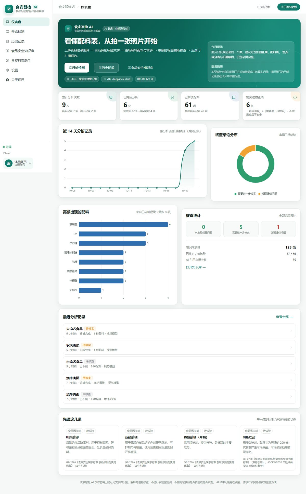
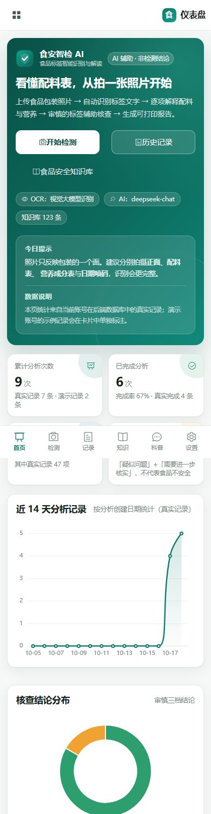
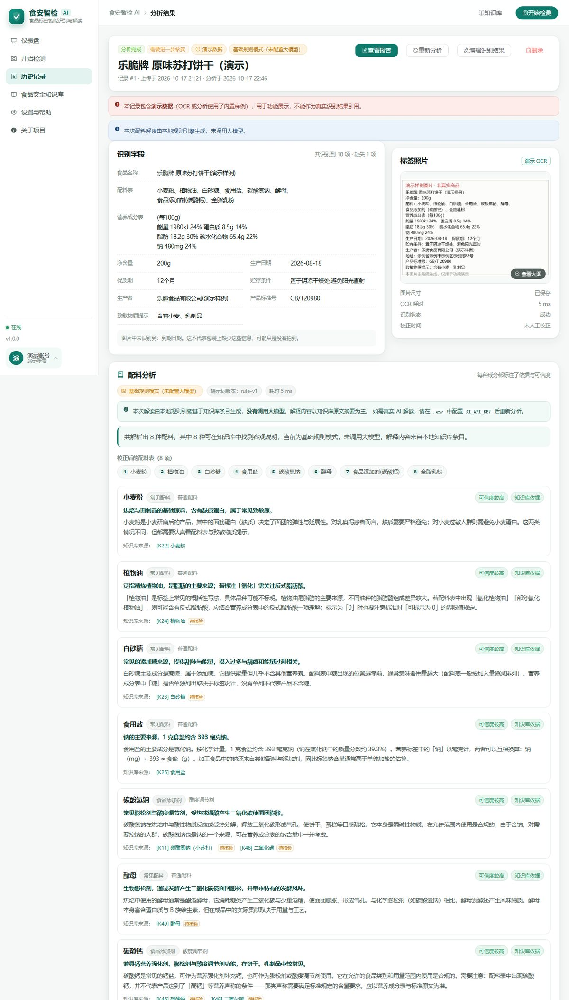
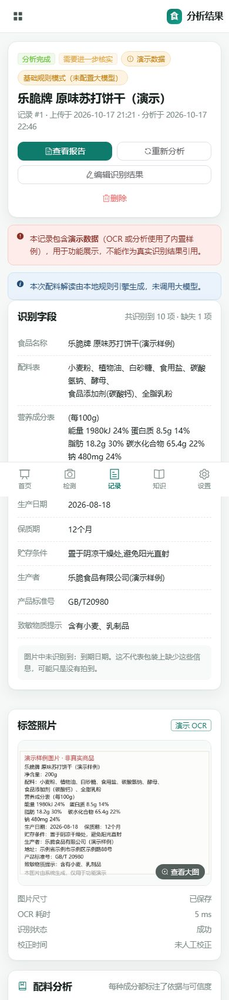
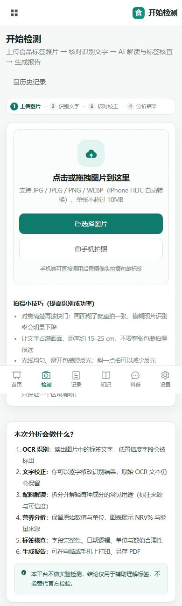
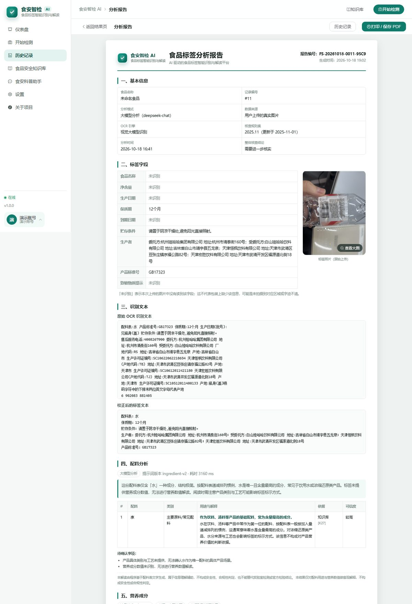
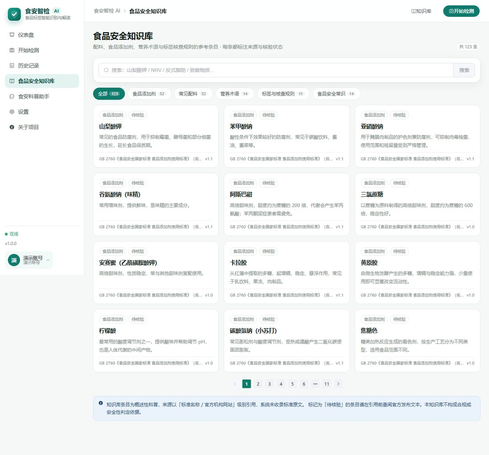
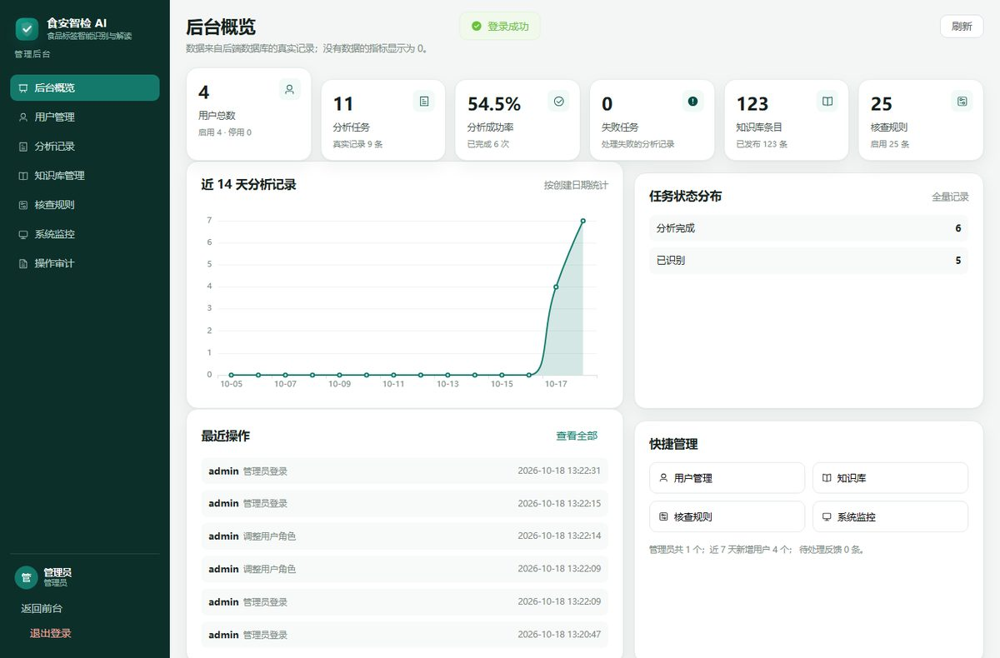

# 智膳 AI · 全场景健康膳食管家

> 面向家庭与个人的健康膳食决策系统：从一张包装/餐盘照片出发，完成识别、解释、画像约束、配餐执行与人工复核闭环。

> **📱 手机端可直接使用**：手机与电脑连接同一 Wi-Fi 后，访问 `http://电脑局域网IP:8000` 即可登录使用；手机与电脑共享同一套后端数据库，分析记录、健康画像、库存与配餐方案实时同步，不是只能在电脑上运行的演示页面。

智膳 AI 不是单一的食物热量查询工具，也不是通用聊天机器人。它把 **多模态识别、健康画像、RAG 证据检索、动态 Prompt、智能配餐 Agent 与后台人工审核** 组织成一条可执行、可追溯、可持续进化的健康决策链路。

用户拍一张包装照片或餐盘照片，系统会完成：

```text
图像上传
  → OCR / 视觉结构化
  → 配料与营养字段解析
  → GB 2760 等知识检索
  → 健康画像与家庭约束注入
  → 风险解释与配餐建议
  → 采购清单 / 烹饪路径
  → 后台审核与反馈回流
```

---

## 目录

- [1. 项目定位](#1-项目定位)
- [2. 核心能力](#2-核心能力)
- [3. 界面预览](#3-界面预览)
- [4. 技术架构](#4-技术架构)
- [5. 快速开始（Windows）](#5-快速开始windows)
- [6. 项目结构](#6-项目结构)
- [7. 配置说明](#7-配置说明)
- [8. 核心接口](#8-核心接口)
- [9. 数据与账号](#9-数据与账号)
- [10. 测试与验证](#10-测试与验证)
- [11. 手机访问与云端部署](#11-手机访问与云端部署)
- [12. 已知限制与免责声明](#12-已知限制与免责声明)
- [13. 后续优化计划](#13-后续优化计划)
- [14. 团队信息](#14-团队信息)

---

## 1. 项目定位

### 1.1 解决什么问题

传统健康膳食产品大多停留在“记录”层：搜索食物、输入份量、查看热量。用户真正需要的，是在具体生活情境下做出下一餐的决策：

- 这个包装食品的配料和添加剂，对我是否合适？
- 家里现有食材如何搭配，才能兼顾营养、慢病和口味？
- 老人、儿童、孕妇与慢病成员的约束，如何在同一顿饭里协调？
- 天气、时间、预算和临期库存变化时，方案如何调整？
- AI 给出的结论，依据是什么，错了由谁复核？

智膳 AI 将“记录工具”升级为“决策系统”：

| 场景 | 平台提供的能力 |
| --- | --- |
| 超市查看配料表 | 拍照得到结构化配料、添加剂与致敏原信息 |
| 看不懂营养成分表 | 保留原始数值与单位，给出每份换算与营养解读 |
| 想知道添加剂用途 | 知识库给出客观用途、适用范围与来源，不做“有毒/不安全”的绝对判断 |
| 家庭成员口味/慢病冲突 | 按成员画像生成建议，过敏原一票否决，慢病约束优先于口味 |
| 冰箱食材快过期 | 临期提醒 + 优先消耗 + 采购补充建议 |
| 不知道今天吃什么 | 结合天气、库存、时间、预算生成三餐方案与烹饪步骤 |
| 后台内容治理 | 知识审核、状态流转、审计日志、人工修正回流 |
| 比赛演示 | 真实 OCR、真实数据库、跨设备访问、SSE 流式输出、PWA |

### 1.2 平台边界

- 只读取包装上可见的文字与用户主动提供的信息，不做实验室检测；
- 不判断微生物、农残、重金属或非法添加；
- 不输出疾病诊断、处方或用药建议；
- 对无法核验的内容明确标注“未核验/仅供参考”；
- 高风险问题建议查看原标签或咨询专业人士。

---

## 2. 核心能力

### 2.1 多模态识包装 / 识饭菜

- 包装正面、配料表、营养成分表多角度识别；
- 餐盘图像识别与份量估算；
- 低质量图片给出重拍提示，而不是强行输出；
- 识别结果分为“原文、结构化字段、AI 解释”；
- 支持用户校正，校正样本进入后台反馈闭环。

### 2.2 健康画像

- 年龄、性别、身高、体重、活动量；
- 减脂、增肌、控糖、控钠、孕期营养等目标；
- 高血压、糖尿病、高尿酸、高血脂等慢病约束；
- 过敏原、忌口、宗教饮食等硬约束；
- 体检单上传与结构化解析；
- 家庭成员档案与共享库存；
- 画像变更后，风险解释与配餐实时重算。

### 2.3 AI Agent 智能配餐

- 结合早中晚三餐、人数、天气、库存、临期、时间与预算；
- 输出菜品、食材、份量、步骤、替换建议；
- 过敏原一票否决；
- 慢病约束优先于口味偏好；
- 临期食材优先消耗；
- 生成采购清单并支持库存扣减；
- 约束无法满足时明确说明，不假装满足。

### 2.4 智膳智库

- 已发布且已核验的知识条目才进入 C 端；
- 覆盖食品添加剂、常见配料、营养术语、标签规则、食安科普、常见菜品；
- 支持关键词检索、分类浏览、详情阅读；
- 分类数量与总数动态取自后端 `total`，不在前端写死；
- 与后台知识库使用同一套状态口径。

### 2.5 冰箱库存与临期提醒

- 手动录入、拍照识别、语音/文本智能导入；
- 临期与过期提醒；
- SSE 实时推送；
- 配餐时优先消耗临期食材；
- 采购清单与库存联动。

### 2.6 家庭空间

- 家庭成员档案；
- 共享库存；
- 家庭防呆提醒；
- 陪伴式 AI 浮窗；
- 让健康管理从“个人自律”变成“家庭协同”。

### 2.7 后台数据中控与人工审核

- 知识库分类、来源、版本、适用范围管理；
- 已发布 / 待审核 / 已下架状态流转；
- 核验状态与发布状态分离；
- 批量审核、上下架；
- OCR 与 AI 结论人工修正；
- 审计日志；
- 审核样本回流，形成 Human-in-the-loop 数据飞轮。

### 2.8 体验与工程能力

- SSE 流式打字机输出；
- PWA 安装与离线提示；
- 响应式布局，手机/电脑双端可用；
- 一键启动脚本，兼容中文与空格路径；
- 模型不可用时规则降级；
- 密钥仅服务端保存，日志脱敏。

---

## 3. 界面预览

| 电脑端仪表盘 | 手机端仪表盘 |
| --- | --- |
|  |  |

| 识别结果（电脑） | 识别结果（手机） |
| --- | --- |
|  |  |

| 上传与识别 | 可打印报告 |
| --- | --- |
|  |  |

| 智膳智库 | 后台管理 |
| --- | --- |
|  |  |

> 截图位于 `docs/images/`。如果图片缺失，页面功能不受影响，可后续补充。

---

## 4. 技术架构

### 4.1 总体分层

```text
┌────────────────────────────────────────────────────────────┐
│  体验层：Vue 3 + TypeScript + Vite + Pinia + Element Plus  │
│  响应式 / SSE 流式渲染 / ECharts / PWA                     │
└──────────────────────────────┬─────────────────────────────┘
                               │ REST / SSE / HTTPS
┌──────────────────────────────▼─────────────────────────────┐
│  API 层：Flask + SQLAlchemy + Waitress（当前可运行实现）    │
│  认证 / 识别 / 画像 / 配餐 / 知识 / 库存 / 后台 / 审计     │
└──────────────────────────────┬─────────────────────────────┘
                               │ 服务调用
┌──────────────────────────────▼─────────────────────────────┐
│  AI 能力层：模型网关 + RAG + Prompt 编排 + 输出校验        │
│  DeepSeek-chat（文本）/ Qwen-VL 系列（视觉）/ 规则引擎      │
└──────────────────────────────┬─────────────────────────────┘
                               │
┌──────────────────────────────▼─────────────────────────────┐
│  数据层：SQLite（开发）/ PostgreSQL（生产建议）             │
│  业务表 + 知识库 + 对象存储 + 审计日志 + 可选 Redis         │
└────────────────────────────────────────────────────────────┘
```

### 4.2 技术栈

| 模块 | 技术 |
| --- | --- |
| 前端框架 | Vue 3 `<script setup>` + TypeScript |
| 构建 | Vite |
| 状态管理 | Pinia |
| 路由 | Vue Router |
| UI 组件 | Element Plus |
| 图表 | ECharts |
| 网络 | Axios + Fetch / ReadableStream（SSE） |
| 后端 | Flask + SQLAlchemy + Waitress |
| 数据库 | SQLite（开发）/ PostgreSQL（生产建议） |
| 文本模型 | DeepSeek-chat（OpenAI 兼容接口） |
| 视觉模型 | Qwen-VL 系列（OpenAI 兼容接口，可切换） |
| 知识约束 | GB 2760、标签通则、营养学术语、平台审核知识 |
| 流式输出 | Server-Sent Events（SSE） |
| 部署 | Windows 一键启动 / Docker / Vercel + Render |

> 说明：当前仓库后端使用 Flask + Waitress，接口按 REST/SSE 契约组织；技术文档中的 FastAPI 为迁移目标，前端契约不依赖具体 WSGI/ASGI 框架。

### 4.3 AI 设计要点

- **文本侧 DeepSeek-chat**：中文理解、长文本解释、JSON 结构化输出、成本可控；
- **视觉侧 Qwen-VL 系列**：包装版面、配料表、营养成分表、表格与开放域视觉问答；
- **统一模型网关**：Base URL、API Key、模型名全部来自环境变量，业务层不绑定供应商；
- **RAG 防幻觉**：知识条目结构化，检索结果带来源，低置信拒答；
- **动态 Prompt**：注入健康画像、天气、库存、临期、时间、预算与约束；
- **输出校验**：JSON Schema + 业务规则 + 引用一致性三层校验；
- **降级策略**：模型超时/不可用时回退规则引擎与本地知识。

### 4.4 SSE 流式输出

识别结果与库存提醒使用 SSE：

```http
GET /api/analyze/dish/{id}/stream
Accept: text/event-stream
```

服务端关键响应头：

```http
Content-Type: text/event-stream
Cache-Control: no-cache
Connection: keep-alive
X-Accel-Buffering: no
```

前端使用 `fetch` + `ReadableStream` 按 `data:` 分帧渲染，形成打字机效果；流结束发送 `[DONE]`，异常时回退普通 JSON 请求。

---

## 5. 快速开始（Windows）

### 5.1 环境要求

- Windows 10/11；
- Python 3.11 或 3.12；
- 已构建的前端产物 `frontend/dist`（仓库已提供；重新构建需要 Node.js 18+）。

### 5.2 一键启动

双击：

```text
start.bat
```

脚本会依次完成：

```text
检查 Python
  → 创建/复用 backend/.venv
  → 检查 .env
  → 安装/校验后端依赖
  → 初始化数据库与知识库
  → 启动后端并静态托管前端
  → 健康检查
  → 打开浏览器
```

访问：

```text
电脑：http://127.0.0.1:8000
手机：http://电脑局域网IP:8000
```

> 手机端与电脑端连接同一 Wi-Fi 即可使用。启动脚本会自动显示当前电脑的局域网访问地址，例如 `http://172.20.10.6:8000`。两端登录同一账号后，数据实时同步。

演示账号：

```text
用户名：demo
密码：demo123456
```

> 如果 `.env` 中修改了 `DEMO_PASSWORD`，以实际配置为准。

### 5.3 重置演示数据

```text
start.bat --reset
```

会重新初始化数据库与种子数据。该操作会覆盖本地演示数据库，请勿在需要保留数据的环境执行。

### 5.4 手动启动

```powershell
# 1. 初始化数据库
.\backend\.venv\Scripts\python.exe .\backend\init_db.py

# 2. 启动后端
cd backend
.\.venv\Scripts\python.exe .\wsgi.py
```

默认端口 `8000`，前端由后端静态托管。

### 5.5 前端重新构建

```powershell
cd frontend
npm install
npm run build
```

构建输出到 `frontend/dist`，后端会自动读取最新产物。

### 5.6 停止服务

```text
双击 stop.bat
```

或结束占用 8000 端口的进程。

---

## 6. 项目结构

```text
zhishan-ai/
├─ backend/
│  ├─ app/
│  │  ├─ api/            # 认证、识别、画像、配餐、知识、后台等路由
│  │  ├─ models/         # SQLAlchemy 模型
│  │  ├─ services/       # AI、RAG、配餐、库存、审核等业务服务
│  │  ├─ utils/          # 响应、错误、校验、安全
│  │  ├─ data/           # 内置知识/菜品数据
│  │  └─ config.py
│  ├─ scripts/           # 数据导入、知识核对等脚本
│  ├─ init_db.py         # 数据库初始化与种子数据
│  ├─ requirements.txt
│  └─ wsgi.py
├─ frontend/
│  ├─ src/
│  │  ├─ api/            # Axios 封装与接口定义
│  │  ├─ components/     # 通用组件
│  │  ├─ layouts/        # 用户端/后台布局
│  │  ├─ router/         # 路由与守卫
│  │  ├─ stores/         # Pinia 状态
│  │  ├─ views/          # 页面
│  │  └─ styles/
│  ├─ public/
│  ├─ dist/              # 构建产物
│  └─ vite.config.ts
├─ data/
│  └─ food_safety.db     # 本地 SQLite 数据库
├─ docs/
│  └─ images/            # README 截图
├─ scripts/
│  └─ start.ps1          # 一键启动 PowerShell 主逻辑
├─ start.bat             # Windows 一键启动入口
├─ stop.bat
├─ Dockerfile
├─ docker-compose.yml
├─ .env.example
└─ README.md
```

---

## 7. 配置说明

复制 `.env.example` 为 `.env`，按需填写。**不要提交真实 API Key。**

### 7.1 应用

```ini
FLASK_ENV=development
SECRET_KEY=change-me
APP_HOST=0.0.0.0
APP_PORT=8000
SERVE_FRONTEND=1
```

### 7.2 文本模型

```ini
AI_PROVIDER=deepseek
AI_BASE_URL=https://api.deepseek.com/v1
AI_API_KEY=
AI_MODEL=deepseek-chat
AI_TIMEOUT=120
AI_TEMPERATURE=0.2
```

### 7.3 视觉模型

```ini
OCR_PROVIDER=vision
OCR_VISION_BASE_URL=
OCR_VISION_API_KEY=
OCR_VISION_MODEL=qwen-vl-max
```

> 视觉接口使用 OpenAI 兼容协议，模型名可按实际服务商调整。

### 7.4 演示账号

```ini
SEED_DEMO_ACCOUNT=1
DEMO_USERNAME=demo
DEMO_PASSWORD=demo123456
```

### 7.5 其他可选配置

```ini
CORS_ORIGINS=http://localhost:8000,http://127.0.0.1:8000
LOGIN_CAPTCHA=0
MAX_CONTENT_LENGTH_MB=10
ASSISTANT_MODE=hybrid
RECIPE_AGENT_MODE=rules
```

未配置模型 Key 时：

- 识别可回退本地 OCR / 规则模式；
- 配餐可回退规则引擎；
- 页面仍可完成基本流程，但 AI 解释能力会下降。

---

## 8. 核心接口

### 8.1 认证

| 方法 | 路径 | 说明 |
| --- | --- | --- |
| POST | `/api/auth/login` | 登录 |
| POST | `/api/auth/register` | 注册 |
| GET | `/api/auth/me` | 当前用户 |
| PUT | `/api/auth/profile` | 更新昵称 |
| POST | `/api/auth/change-password` | 修改密码 |
| POST | `/api/auth/logout` | 退出登录 |

### 8.2 识别与分析

| 方法 | 路径 | 说明 |
| --- | --- | --- |
| POST | `/api/upload` | 上传图片 |
| POST | `/api/ocr` | OCR / 视觉结构化 |
| POST | `/api/analyze` | 配料、营养、风险分析 |
| GET | `/api/analyze/dish/{id}/stream` | 识别结果 SSE |
| GET | `/api/records` | 历史记录 |
| GET | `/api/records/{id}` | 记录详情 |

### 8.3 健康画像与配餐

| 方法 | 路径 | 说明 |
| --- | --- | --- |
| GET/PUT | `/api/profile` | 健康画像 |
| POST | `/api/profile/parse-report` | 体检单解析 |
| GET/POST | `/api/plans` | 配餐方案 |
| POST | `/api/recipes/complete` | 完成一餐并扣减库存 |
| GET | `/api/shopping-list` | 采购清单 |

### 8.4 知识库

| 方法 | 路径 | 说明 |
| --- | --- | --- |
| GET | `/api/knowledge` | 已发布且已核验知识 |
| GET | `/api/knowledge/{id}` | 知识详情 |
| GET | `/api/dishes` | 常见菜品营养库 |

### 8.5 库存与家庭

| 方法 | 路径 | 说明 |
| --- | --- | --- |
| GET/POST | `/api/pantry` | 库存列表与新增 |
| PUT/DELETE | `/api/pantry/{id}` | 更新/删除库存 |
| GET | `/api/pantry/stream` | 临期提醒 SSE |
| GET/POST | `/api/family` | 家庭成员 |

### 8.6 后台

| 方法 | 路径 | 说明 |
| --- | --- | --- |
| POST | `/api/admin/login` | 管理员登录 |
| GET | `/api/admin/dashboard` | 后台概览 |
| GET | `/api/admin/knowledge` | 知识库管理 |
| POST | `/api/admin/knowledge` | 新建知识 |
| PUT | `/api/admin/knowledge/{id}` | 更新知识 |
| POST | `/api/admin/knowledge/{id}/verify` | 审核通过 |
| POST | `/api/admin/knowledge/{id}/publish` | 发布/下架 |
| POST | `/api/admin/knowledge/{id}/enrich` | 菜品知识补全 |
| GET | `/api/admin/monitor` | 系统监控 |
| GET | `/api/admin/audit-logs` | 操作审计 |
| GET | `/api/admin/feedback` | 用户反馈 |

> 详细字段与响应结构以 `backend/app/api/` 与前端 `frontend/src/api/` 为准。

---

## 9. 数据与账号

### 9.1 数据库

默认：

```text
data/food_safety.db
```

初始化脚本：

```text
backend/init_db.py
```

种子数据包含：

- 知识库条目；
- 科普问答；
- 核查规则；
- 演示账号；
- 演示分析记录。

### 9.2 图片与文件

```text
uploads/
```

上传文件会做扩展名、MIME、大小与路径校验。

### 9.3 演示账号

```text
demo / demo123456
```

仅用于本地演示，请在真实部署环境修改密码与密钥。

### 9.4 知识库状态口径

C 端智膳智库只展示：

```text
status = published
verification_status = verified
```

后台状态分为：

```text
全部
已发布（published + verified）
待审核（草稿 + 已发布但未核验）
已下架（offline）
```

前后端使用同一套口径，避免“后台 128、C 端 167”的统计不一致。

### 9.5 可选：导入菜品营养库

```powershell
.\backend\.venv\Scripts\python.exe .\backend\scripts\import_dish_library.py
```

该脚本为**增量导入**，不会删除已有数据。

---

## 10. 测试与验证

### 10.1 后端测试

```powershell
.\backend\.venv\Scripts\python.exe -m pytest
```

或双击：

```text
run_tests.bat
```

### 10.2 前端构建检查

```powershell
cd frontend
npm run build
```

### 10.3 健康检查

```text
GET http://127.0.0.1:8000/api/health
```

### 10.4 手工验收清单

- [ ] 登录 / 注册 / 退出；
- [ ] 上传包装图片，完成 OCR 与识别；
- [ ] 查看配料、营养与风险解释；
- [ ] 建立健康画像并验证配餐约束；
- [ ] 生成三餐方案与采购清单；
- [ ] 库存临期提醒；
- [ ] 后台知识审核与状态流转；
- [ ] 审核操作写入审计日志；
- [ ] 手机与电脑访问同一账号数据一致；
- [ ] 模型不可用时规则降级可用。

---

## 11. 手机访问与云端部署

### 11.1 手机访问（同一 Wi-Fi）

1. 确认电脑与手机连接同一 Wi-Fi；
2. 查看电脑局域网 IP：

```powershell
ipconfig
```

3. 手机访问：

```text
http://电脑局域网IP:8000
```

4. 如果无法访问，检查 Windows 防火墙是否允许 Python / 8000 端口。

不要使用：

```text
http://localhost:8000
http://127.0.0.1:8000
```

手机上的 `localhost` 指向手机自身。

### 11.2 Vercel（前端）

- Framework：Vite；
- Build Command：`npm run build`；
- Output Directory：`dist`；
- 环境变量：`VITE_API_BASE_URL=https://你的后端域名/api`；
- 配置 SPA 路由回退。

### 11.3 Render（后端）

- 启动命令：`python wsgi.py`（当前 Flask 实现）；
- 环境变量：`SECRET_KEY`、`AI_API_KEY`、`OCR_VISION_API_KEY`、`CORS_ORIGINS`；
- 健康检查：`/api/health`；
- 对 SSE 关闭代理缓冲；
- 生产数据库建议 PostgreSQL。

### 11.4 Docker（可选）

```powershell
docker compose up --build
```

具体端口与环境变量见 `docker-compose.yml`。

---

## 12. 已知限制与免责声明

### 12.1 已知限制

- 本地演示使用 SQLite，生产高并发建议 PostgreSQL；
- 模型输出存在不确定性，低置信场景需要人工复核；
- 图片质量、反光、遮挡会影响识别结果；
- 知识库覆盖范围有限，不能替代完整法规数据库；
- 云端部署需要自行配置域名、HTTPS、数据库与密钥；
- 当前前端构建产物与后端静态托管面向演示环境。

### 12.2 免责声明

本项目仅用于学习、比赛演示与健康饮食参考，不构成医疗诊断、治疗建议或食品安全检测结论。涉及疾病、用药、孕期、婴幼儿及特殊医学用途食品时，请咨询医生或注册营养师。食品标签与法规以官方发布文本为准。

---

## 13. 后续优化计划

- 扩展知识库覆盖与版本管理；
- 引入向量检索与混合检索，提高召回质量；
- 增加批量审核与审核工作台；
- 将 SQLite 迁移至 PostgreSQL，补充 Redis 缓存；
- 增加模型调用成本与延迟监控；
- 支持更多视觉模型与多语言标签；
- 完善离线评测集与 A/B 实验；
- 开放 API，接入机构知识库与营养师工作台。

---

## 14. 团队信息

| 项目 | 内容 |
| --- | --- |
| 团队名称 | 智膳 AI 团队 |
| 参赛项目 | 智膳 AI · 全场景健康膳食管家 |
| 项目负责人 | 赵帅然 |
| 团队成员 | 赵帅然、董子航、董海潇 |
| 团队分工 | 产品与需求分析、前端开发、后端与 AI 工程、测试与演示材料 |
| 联系方式 | 通过 GitHub Issues 联系 |

### 14.1 成员分工

| 成员 | 角色 | 主要职责 |
| --- | --- | --- |
| 赵帅然 | 项目负责人 / 产品与架构 | 需求分析、产品设计、系统架构、答辩统筹 |
| 董海潇| 前端开发 | Vue 3 页面、交互、SSE 流式渲染、响应式适配 |
| 董子航 | 后端与 AI 工程 | API、数据库、RAG、Prompt、模型接入与审核链路 |
| 赵帅然、董子航、董海潇 | 测试与运营 | 测试用例、数据核对、演示脚本与文档整理 |


---

**智膳 AI：让每一顿饭，都有证据、有情境、有执行路径。**
